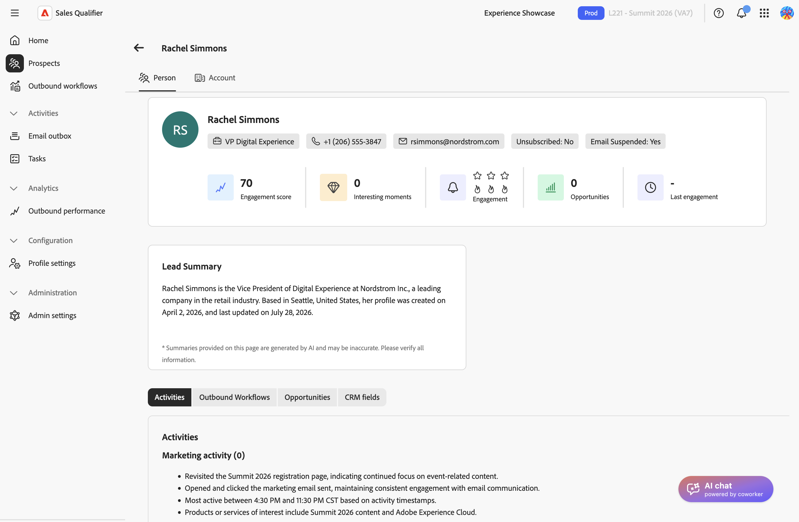

# 계정

계정 보기에는 AI가 생성한 리서치, 최근 뉴스, 오픈 기회, 파이프라인 가치 및 참여 연락처가 결합됩니다. 연락하기 전에 이 정보를 사용하여 계정을 이해하고 우선 순위를 지정합니다.

## 계정 열기

연결된 잠재 고객의 프로필에서 계정을 엽니다.

1. 왼쪽 탐색에서 **[!UICONTROL 잠재 고객]**&#x200B;을 선택하고 잠재 고객을 여십시오. [잠재 고객](prospects.md)을 참조하세요.
1. 잠재 고객 세부 정보 페이지에서 **[!UICONTROL 계정]** 탭을 선택합니다.

{width="800" zoomable="yes"}

Adobe Marketo Qualifier는 잠재 고객의 CRM 레코드에서 계정을 식별합니다. 해당 계정과 연결된 모든 잠재 고객에서 동일한 계정 보기를 사용할 수 있습니다. Marketo 한정자가 계정과 일치하지 않으면 탭에 _계정을 찾을 수 없음_&#x200B;이 표시됩니다.

>[!NOTE]
>
>사용 가능한 섹션 및 지표는 CRM, 조직의 구성 및 계정 데이터에 따라 다릅니다. 여기에 설명된 섹션이 나타나지 않으면 필요한 데이터나 기능이 구성되지 않습니다.

계정 보기에는 **[!UICONTROL 세부 정보]** 및 **[!UICONTROL 계정 조사]**&#x200B;의 두 가지 탭이 있습니다.

## 계정 세부 정보 검토

**[!UICONTROL 세부 정보]** 탭에는 계정 및 해당 파이프라인의 스냅숏이 표시됩니다.

### 계정 개요

탭 상단의 개요 카드는 계정을 식별하고 해당 값을 요약합니다.

* 계정 이름 및 지역
* **연간 되풀이 매출(ARR)** - 모든 활성 구독의 연간 되풀이 매출입니다. **[!UICONTROL 연간 되풀이 매출]** 대화 상자에서 제품별 ARR을 검토하려면 **[!UICONTROL 모두 보기]**&#x200B;를 선택하십시오.
* 영업 기회 및 연락처 수와 파이프라인 값을 포함한 계정 통계

### 계정 개요 요약

**[!UICONTROL 계정 개요]** 패널에 CRM 데이터 및 Account Qualification Agent 조사를 기반으로 하는 계정이 요약됩니다. 연구가 진행 중인 경우 패널에 로드 상태가 표시됩니다. 연구를 사용할 수 없는 경우 패널에 메시지가 표시됩니다.

### 계정 인사이트

개요 아래의 버튼을 사용하여 계정 보기 간에 전환할 수 있습니다. 사용 가능한 보기는 CRM 및 구성에 따라 다릅니다.

| 보기 | 표시 내용 |
| --- | --- |
| **[!UICONTROL 기회]** | 각 고객에 대한 주요 필드가 있는 계정에 연결된 영업 기회를 엽니다. 테이블의 전체 목록을 보려면 **[!UICONTROL 모두 보기]**&#x200B;를 선택하십시오. 단계, 유형 및 종료 날짜 등 영업 기회 세부 정보를 사용하여 관리자가 해당 필드를 필터링 가능하도록 만들면 **[!UICONTROL 내 영업 기회 연락처]**&#x200B;에서 해당 계정의 연락처를 필터링할 수도 있습니다. |
| **[!UICONTROL 상위 멤버]** | 거래별로 순위가 매겨진 거래처의 주요 참여 연락처. 각 연락처에는 직책, 이메일 주소, 참여 점수 및 긴급도 표시기가 표시됩니다. |
| **[!UICONTROL 의도 데이터]** | 계정이 조사 중인 제품 및 주제와 같은 계정에 대한 구매 의도 신호. |
| **[!UICONTROL 계정 팀원]** | 이메일, 직함, 지역 및 제품 그룹과 함께 계정에 할당된 직원입니다. |
| **[!UICONTROL CRM 필드]** | 인바운드 매핑에 구성된 대로 CRM에서 가져온 계정 필드. [통합](integrations.md#map-crm-fields-inbound-mapping)을 참조하세요. |

**[!UICONTROL 최상위 구성원]** 보기에서 연락처에 대해 다음 작업 중 하나를 수행합니다.

* **[!UICONTROL 아웃바운드 워크플로에 추가]**—연락처를 [아웃바운드 워크플로에 등록](outbound-workflows.md)합니다.
* **[!UICONTROL Marketo 캠페인에 추가]**—연락처에 대한 [!DNL Marketo] 캠페인을 트리거합니다.

## 계정 조사

**[!UICONTROL 계정 조사]** 탭에는 다음 세 가지 영역이 있습니다.

* **[!UICONTROL 연구 범주]** - 연구 주제. 중앙 창에서 조사할 범주를 선택합니다.
* **연구 콘텐츠**—범주별로 그룹화된 AI 생성 연구 카드. 카드에는 소스 도메인과 신호가 처음 감지된 날짜와 마지막으로 감지된 날짜가 포함될 수 있습니다.
* **[!UICONTROL 최근 뉴스]** - 날짜, 태그 및 소스 링크를 포함하여 계정에 대한 최신 뉴스입니다.

{width="800" zoomable="yes"}

리서치 또는 뉴스를 로드할 수 없는 경우 각 영역에는 **[!UICONTROL 다시 로드]** 작업이 제공됩니다.

## 지원 센터에서 계정 인텔리전스 사용

계정 인텔리전스는 보내는 내용을 구체화할 때 가장 중요합니다.

* 일반적인 피치를 사용하는 대신 최근 뉴스 항목 또는 리서치 신호를 참조하여 오프닝을 적절하도록 하십시오.
* 개설 기회 및 파이프라인 값을 확인하여 계정의 우선 순위를 정할지 여부를 결정합니다.
* **[!UICONTROL 최상위 구성원]**&#x200B;을(를) 사용하여 연락할 사람을 식별한 다음 아웃바운드 워크플로우에 등록합니다.
* 통화 전에 [AI 채팅](ai-assistant.md)에 계정에 대한 위치를 개발하도록 요청하세요.

>[!MORELIKETHIS]
>
>* [잠재 고객](prospects.md)
>* [아웃바운드 워크플로](outbound-workflows.md)
>* [AI 채팅](ai-assistant.md)
