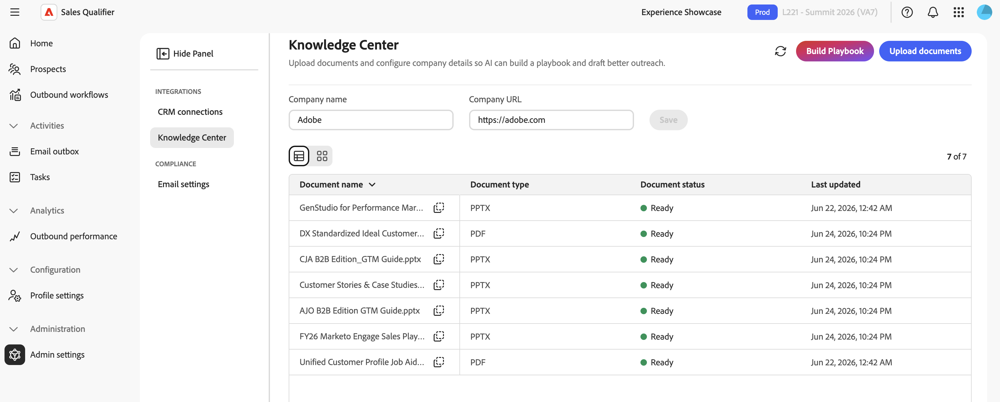

# 관리자 설정

**[!UICONTROL 관리 설정]**&#x200B;을 사용하여 CRM 통합을 구성하고, 지식 센터를 관리하고, 전자 메일 옵트아웃을 구성하십시오.

[!DNL Adobe Marketo Qualifier]이(가) Salesforce 또는 Microsoft Dynamics 365에 연결합니다. 이 연결을 통해 Account Qualification Agent(AQA)에는 리드, 계정, 연락처, 활동 및 소유자에 대한 일관된 보기가 제공됩니다. Marketo Qualifier은 또한 CRM에 전달 활동 및 옵트아웃 상태를 다시 쓰고 Marketo에 전달 활동을 동기화할 수 있습니다.

CRM 연결, 필드 매핑 및 활동 동기화를 구성하려면 **[!UICONTROL 관리]** > **[!UICONTROL 관리 설정]** > **[!UICONTROL CRM 연결]**&#x200B;로 이동합니다. 표준 사용자는 구성된 CRM 데이터 및 필터를 사용할 수 있지만 이러한 설정을 변경할 수는 없습니다. CRM을 처음 연결하려면 [시작](getting-started.md#connect-your-crm)을 참조하세요.

>[!IMPORTANT]
>
>**[!UICONTROL 관리자 설정]**&#x200B;에 액세스하려면 `Marketo Qualifier` 및 `Marketo Qualifier Admins` 사용자 그룹 모두의 구성원이 필요합니다.

## CRM MCP 및 포함된 플러그인

Marketo Qualifier은 다음과 같은 방식으로 CRM과 작동합니다.

* **CRM MCP 쿼리** - Account Qualification Agent은 라이브 CRM 데이터를 쿼리하여 응답과 통찰력이 레코드의 현재 상태를 반영하도록 합니다.
* **포함된 플러그인**—CRM 플러그인은 CRM의 [!DNL Marketo Sales Insights]&#x200B;(MSI) 인사이트 및 에이전트 데이터를 표시합니다. 플러그 인을 사용하여 [!DNL Marketo Qualifier]에 잠재 고객을 추가하십시오.
* **활동 동기화**—관리자가 **[!UICONTROL 활동 동기화]**&#x200B;를 켜면 봉사 활동이 CRM 및 Marketo에 동기화됩니다.

### CRM 플러그인의 잠재 고객 우선 순위 지정

CRM 플러그인은 대표가 CRM을 떠나지 않고 잠재 고객을 우선 지정할 수 있는 기본 홈을 제공합니다. 사용 가능한 탭은 소스 및 인텐트별로 작업을 구성합니다.

* **[!UICONTROL 최상의 선택]** - 수행할 준비가 된 잠재 고객 권장 사항입니다.
* **[!UICONTROL 내 시청 목록]**—추적 중인 잠재 고객.
* **[!UICONTROL 웹 활동]**—알려진 잠재 고객의 최근 사이트 방문 횟수입니다.
* **[!UICONTROL 익명 웹 활동]** - 확인되지 않은 방문자의 방문.
* **[!UICONTROL 내 이메일]**—잠재 고객과 연결된 이메일 참여
* **[!UICONTROL 웨비나]**—웨비나 등록 및 참석 활동.

각 잠재 고객에는 [!DNL Marketo] 이메일 미리 보기, 잠재 고객 세부 정보에 대한 링크 및 LinkedIn 연구가 포함될 수 있습니다. 액세스할 수 있는 탭 및 데이터는 CRM 플러그인 구성에 따라 다릅니다.

## CRM 액세스 범위

Marketo Qualifier은 CRM에서 사용자, 연락처, 소유자 매핑, 리드, 계정, 기회 및 활동을 읽습니다. 기록된 전달 활동 및 옵트아웃 상태만 CRM에 쓰고, 전달 활동을 Marketo에 동기화합니다. CRM 관리자는 Salesforce 또는 Dynamics에서 API 액세스를 준비합니다. 그런 다음 Marketo Qualifier 관리자가 CRM을 연결하고 인바운드 필드를 매핑한 다음 활동을 동기화할지 여부를 선택합니다.

>[!NOTE]
>
>[시작](getting-started.md#connect-your-crm)의 자격 증명 단계에서 CRM 개체에 대한 읽기 액세스를 설명합니다. 활동 동기화 또는 옵트아웃 다시 쓰기를 켜는 경우 CRM 관리자와 함께 CRM 구성에 필요한 해당 쓰기 액세스 권한을 부여합니다.

## CRM 필드 매핑(인바운드 매핑)

CRM이 연결된 후 연결을 위해 **[!UICONTROL 관리]**&#x200B;를 선택하고 **[!UICONTROL 인바운드 매핑]**&#x200B;을 엽니다. 인바운드 매핑은 Marketo Qualifier이 애플리케이션으로 가져오는 CRM 필드를 제어합니다.

1. **[!UICONTROL 섹션 추가]**&#x200B;를 선택합니다.
1. 섹션 이름과 설명을 입력합니다.
1. 엔터티 유형을 선택합니다. 기본적으로 **[!UICONTROL 잠재 고객]**&#x200B;이 선택됩니다. **[!UICONTROL 연락처]**, **[!UICONTROL 계정]** 및 **[!UICONTROL 기회]**&#x200B;도 사용할 수 있습니다.
1. CRM 필드를 가져오려면 필드를 선택합니다.

   각 필드 행에는 **[!UICONTROL 표시 이름]**, **[!UICONTROL 필드 이름]** 및 **[!UICONTROL 데이터 형식]**&#x200B;이 표시됩니다.

1. **[!UICONTROL 잠재 고객]** 목록 및 [아웃바운드 워크플로 타깃팅](outbound-workflows.md#step-2-configure-targeting-filters)에서 필터로 사용할 수 있도록 하려는 각 잠재 고객, 연락처, 계정 또는 기회 필드에 대해 **[!UICONTROL 필터링 가능]**&#x200B;을 설정합니다.
1. 섹션을 미리 보고 **[!UICONTROL 추가]**&#x200B;를 선택합니다.

매핑된 필드는 Marketo Qualifier의 해당 영역에 표시됩니다.

* 잠재 고객 필드는 **[!UICONTROL 개인]** 탭에 나타납니다.
* 계정 필드는 **[!UICONTROL 계정]** 탭에 나타납니다. **[!UICONTROL Accounts]** 엔터티 형식이 있는 섹션에서 담당자가 연결된 계정의 특성(예: 업계, 지역 또는 계정 형식)별로 연락처를 필터링할 수 있도록 필드를 필터링할 수 있도록 합니다.
* 영업 기회 필드는 **[!UICONTROL 계정 영업 기회]** 섹션에 표시됩니다. 필터링 가능한 영업 기회 필드는 **[!UICONTROL 내 영업 기회 연락처]**&#x200B;에도 고유한 열로 표시되며, 연락처 필드와 구분하기 위해 **[!UICONTROL 단계(영업 기회)]**&#x200B;와 같은 레이블이 있습니다.

계정 필드 필터링은 Salesforce 및 Microsoft Dynamics 365에서 사용할 수 있습니다. 담당자는 필터링 가능한 계정, 연락처 및 기회 필드를 결합하여 연락처를 찾고 아웃바운드 워크플로우 타깃팅 기준을 정의할 수 있습니다.

## 활동 동기화 구성(아웃바운드 매핑)

1. **[!UICONTROL CRM 연결]**&#x200B;에서 연결된 CRM에 대해 **[!UICONTROL 관리]**&#x200B;를 선택합니다.
1. **[!UICONTROL 아웃바운드 매핑]**&#x200B;을 엽니다.
1. **[!UICONTROL 활동 동기화]**&#x200B;를 켜서 Marketo Qualifier 지원 활동을 CRM 및 Marketo에 다시 동기화합니다.

활동 동기화가 꺼져 있으면 Marketo Qualifier에서 인바운드 CRM 데이터를 계속 사용하지만 아웃바운드 활동을 CRM 또는 Marketo에 동기화하지 않습니다.

## CRM 동기화 규칙 구성

잠재 고객이 아웃바운드 워크플로우를 통해 이동할 때 Marketo Qualifier에서 리드 상태 업데이트를 Salesforce 및 Microsoft Dynamics에 자동으로 다시 쓸 수 있으므로 담당자가 더 이상 수동으로 CRM을 업데이트하지 않습니다.

### CRM 동기화 규칙의 기능

업데이트는 잠재 고객 뿐만 아니라 **[!UICONTROL 잠재 고객]**, **[!UICONTROL 연락처]**, **[!UICONTROL 계정]** 또는 **[!UICONTROL 기회]** 레코드도 타깃팅할 수 있습니다.

업데이트는 다음과 같은 아웃바운드 워크플로 순간에 실행됩니다.

* 워크플로우에 추가됨, 회신됨 또는 예약된 회의
* 회신하지 않고 완료된 담당자 또는 워크플로에서 제거됨
* 옵트아웃 또는 반송된 이메일

필드 값은 동적 토큰으로 개인화할 수 있으므로 CRM 업데이트는 정적 값이 아닌 잠재 고객의 실제 여정을 반영합니다. 대표자 이름, 아웃바운드 워크플로 이름, 모임 날짜 및 시간 등 세부 정보에 대한 토큰을 사용할 수 있습니다.

CRM 호환 값만 기록되고, 실패한 필드 하나가 다른 필드를 차단하지 않으며, 일시적인 문제가 자동으로 다시 시도됩니다. 동기화된 항목과 주의가 필요한 항목을 확인할 수 있도록 모든 업데이트가 추적됩니다.

### CRM 동기화 규칙 설정

CRM 동기화 규칙을 설정하려면:

1. 왼쪽 탐색에서 **[!UICONTROL 관리]**&#x200B;를 확장하고 **[!UICONTROL 관리 설정]** > **[!UICONTROL CRM 연결]**&#x200B;을 선택합니다.
1. 연결된 CRM에 대해 **[!UICONTROL 관리]**&#x200B;를 선택한 다음 **[!UICONTROL 동기화 규칙]**&#x200B;을 선택합니다.
1. 대상 CRM 엔터티 및 필드를 선택하고 위의 워크플로 모멘트에 매핑한 다음 토글을 켭니다.

CRM 동기화 규칙이 구성되면 영업 팀은 모든 단계에서 데이터 지연 및 수동 작업을 줄이면서 리드, 연락처, 계정 및 기회에 걸쳐 정확하고 개인화된 최신 상태를 확인할 수 있습니다.

## 지식 센터 플레이북 구축 {#knowledge-center}

**[!UICONTROL 기술 센터]**&#x200B;에서 Account Qualification Agent(AQA)에 영업 자료에 액세스할 수 있습니다. Marketo Qualifier은 이러한 자료를 사용하여 조직의 판매 방식을 반영하는 연구, 자격 통찰력 및 전달을 생성합니다. 관리자만 플레이북을 빌드하고 관리할 수 있습니다.

{width="800" zoomable="yes"}

1. 왼쪽 탐색에서 **[!UICONTROL 관리]**&#x200B;를 확장하고 **[!UICONTROL 관리 설정]**&#x200B;을 선택한 다음 **[!UICONTROL 기술 자료 센터]**&#x200B;를 선택합니다.
1. Marketo Qualifier에서 회사 및 초안 전자 메일을 조사하는 데 사용하는 **[!UICONTROL 회사 이름]** 및 **[!UICONTROL 회사 URL]**&#x200B;을 설정합니다.
1. PDF, PPTX 또는 DOCX 포맷으로 영업 전략, 이상적인 고객 프로필(ICP), 포지셔닝 가이드 및 기타 영업 자료를 업로드합니다.
1. **[!UICONTROL 플레이북 빌드]**&#x200B;를 선택합니다.

이 페이지에는 가장 최근에 작성한 플레이북의 상태가 표시되며, 콘텐츠를 업로드한 후 다음 작업을 제공합니다. 빌드 후 최신 상태를 검색하려면 **[!UICONTROL 새로 고침]**&#x200B;을 선택하십시오.

업로드된 각 문서에는 **[!UICONTROL 준비]**&#x200B;와 같은 처리 상태와 마지막으로 업데이트된 시간도 표시됩니다.

>[!NOTE]
>
>플레이북은 처리하는 데 최대 24시간이 걸릴 수 있습니다.

플레이북이 준비되면 대표는 다음 두 곳에서 사용할 수 있습니다.

* **아웃바운드 전자 메일 프롬프트**—접점 프롬프트에서 문서 이름을 지정하고 사용할 컨텍스트를 설명합니다. 예를 들어 `Use the ABC positioning guide from the Knowledge Center and focus on the security value proposition`을(를) 입력합니다. [터치포인트 구성](outbound-workflows.md#step-3-generate-and-review-touchpoints)을 참조하세요.
* **AI 채팅**: 질문에 있는 기술 지원 센터를 참조하세요. 예를 들어 `From the Knowledge Center, help me position our security solution for ABC Corp before tomorrow's call`을(를) 입력합니다. [AI 채팅](ai-assistant.md)을 참조하세요.

두 경우 모두, 생성된 콘텐츠는 일반적인 연구가 아닌 플레이북의 메시지를 반영합니다.

## 글로벌 이메일 옵트아웃 구성

1. 왼쪽 탐색에서 **[!UICONTROL 관리]**&#x200B;를 확장하고 **[!UICONTROL 관리 설정]**&#x200B;을 선택합니다.
1. **[!UICONTROL 준수]**&#x200B;에서 **[!UICONTROL 전자 메일 설정]**&#x200B;을 선택하세요.
1. **[!UICONTROL 모든 전자 메일에 옵트아웃 링크 포함]**&#x200B;을 켜서 아웃바운드 전자 메일에 구독 취소 바닥글을 추가합니다.
1. **[!UICONTROL 옵트아웃 메시지 템플릿]**&#x200B;에 바닥글 텍스트를 입력하십시오. 구독 취소 링크가 표시되어야 하는 `{opt_out_link}` 토큰을 포함합니다.

설정이 자동으로 저장됩니다.

잠재 고객이 링크를 선택하면 Marketo Qualifier은 해당 잠재 고객에게 이메일 전송을 중단하고 옵트아웃 상태를 연결된 CRM에 동기화합니다. 또한 Marketo Qualifier은 잠재 고객의 이메일 회신에서 &quot;이메일 수신을 중단하십시오&quot; 또는 &quot;구독 취소&quot;와 같은 명확한 옵트아웃 요청을 인식하고 해당 잠재 고객을 자동으로 옵트아웃으로 표시합니다. 동일한 **[!UICONTROL 옵트아웃]** 상태 및 배지가 적용되며, 더 이상 터치포인트를 보내지 않습니다. 추가 설정이 필요하지 않습니다. &quot;지금 아님&quot;과 같이 명백히 중지를 요청하지 않는 답글은 옵트아웃으로 처리되지 않습니다. [회신에서 옵트아웃 요청](outbound-workflows.md#opt-out-requests-in-replies)을 참조하세요.

## 참조: 샘플 API 매개 변수

CRM 팀은 이러한 예를 사용하여 읽기 액세스가 예상 리드 필드를 반환하는지 확인할 수 있습니다.

### Dynamics OData 예

```text
$select=fullname,_ownerid_value,leadid,emailaddress1,jobtitle,statuscode,createdon,modifiedon,statecode
$filter=_ownerid_value eq '<crmUserId>' [AND additional filters]
$expand=Lead_ActivityPointers(...),parentaccountid(...)
$orderby=modifiedon desc
```

### Salesforce SOQL 예

```sql
SELECT Id, Salutation, FirstName, LastName, Name, Title, Company, Email,
  LeadSource, Status, OwnerId, LastModifiedDate, LastActivityDate, CreatedDate,
  (SELECT Id, Subject, ActivityDate, Status FROM Tasks ORDER BY ActivityDate DESC LIMIT 1),
  (SELECT Id, Subject, ActivityDateTime FROM Events ORDER BY ActivityDateTime DESC LIMIT 1)
FROM Lead
WHERE OwnerId = '<crmUserId>' AND IsDeleted = false
ORDER BY LastModifiedDate DESC
```

>[!MORELIKETHIS]
>
>* [시작](getting-started.md)
>* [잠재 고객](prospects.md)
