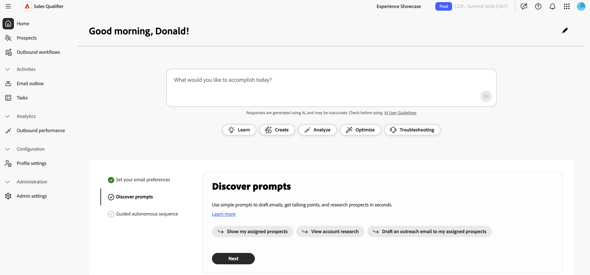
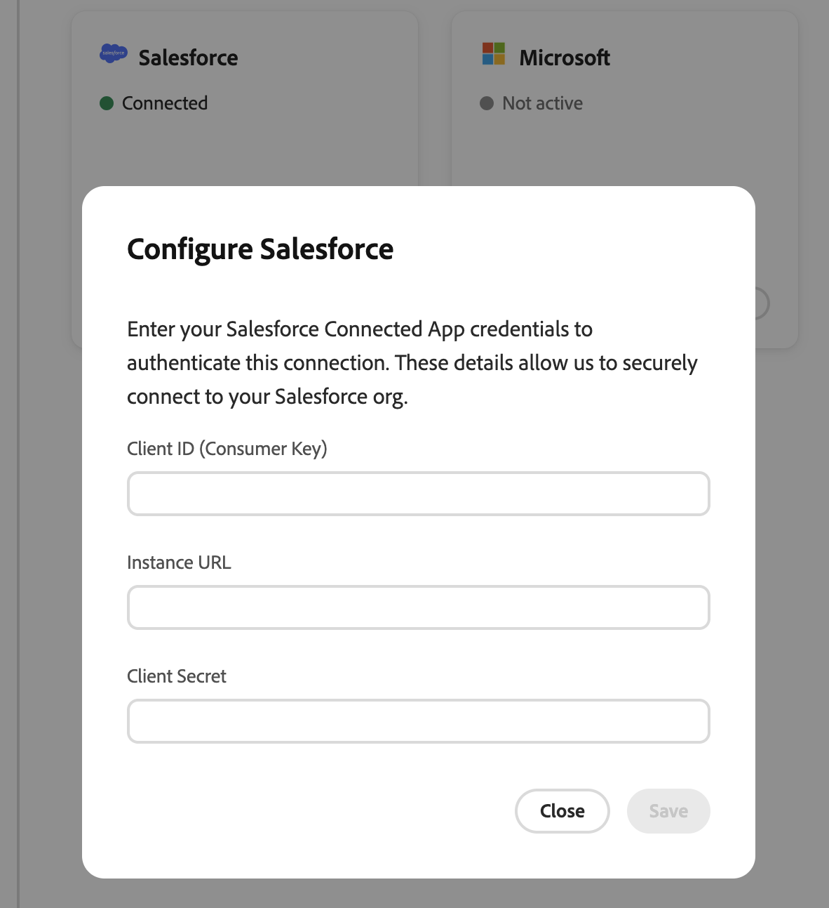

# Sales Qualifier 시작

Adobe에서 조직에 Sales Qualifier을 프로비전한 후에는 [!DNL Marketo] 시스템 관리자가 필요한 사용자 그룹을 만들고 Salesforce 또는 Microsoft Dynamics 365에 연결해야 합니다.

{width="800" zoomable="yes"}

## 사용자 그룹 설정

Adobe Admin Console의 사용자 그룹은 Sales Qualifier에 대한 액세스를 제어하는 데 사용됩니다. 사용자가 로그인하려면 두 그룹을 모두 만들어야 합니다.

그룹 설정에 대한 자세한 내용은 [Adobe Admin Console 설명서](https://helpx.adobe.com/business/enterprise/users/users-and-groups/user-groups.html)를 참조하세요.

>[!PREREQUISITES]
>
>그룹을 생성하는 관리자는 다음 두 요구 사항을 모두 충족해야 합니다.
>
>* Adobe 앱 전환기에서 **[!UICONTROL Admin Console]**&#x200B;에 액세스할 수 있는 조직 관리자가 되십시오.
>* Adobe Experience Platform 제품에 할당되거나 시스템 관리자가 될 수 있습니다. 그렇지 않으면 Adobe Experience Platform이 제품 목록에 표시되지 않습니다.

### Sales Qualifier 사용자

응용 프로그램에 액세스하려면 사용자가 `Sales Qualifier` 사용자 그룹에 속해야 합니다.

이 단계는 Adobe Admin Console에서 수행됩니다.

1. 9개 점이 있는 앱 전환기에서 **[!UICONTROL Admin Console]**&#x200B;을(를) 선택합니다.
1. **[!UICONTROL 사용자]** > **[!UICONTROL 사용자 그룹]** > **[!UICONTROL 새 사용자 그룹]**&#x200B;을 선택합니다.
1. 그룹 이름으로 `Sales Qualifier`을(를) 입력하고 **[!UICONTROL 저장]**&#x200B;을(를) 선택합니다.
1. **[!UICONTROL 할당된 제품 프로필]**&#x200B;을 연 다음 **[!UICONTROL 프로필 할당]**&#x200B;을 선택하세요.
1. **[!UICONTROL Adobe Experience Platform]**&#x200B;을(를) 선택합니다.
1. **[!UICONTROL 기본 프로덕션 모든 액세스]** 제품 프로필을 선택하고 **[!UICONTROL 적용]**&#x200B;을 선택한 다음 **[!UICONTROL 저장]**&#x200B;을 선택합니다.
1. **[!UICONTROL 사용자]**&#x200B;를 열고 **[!UICONTROL 사용자 추가]**&#x200B;를 선택하여 Sales Qualifier에 액세스해야 하는 모든 사용자를 추가합니다.

### Sales Qualifier 관리자

CRM 연결, [기술 센터](admin-settings.md#knowledge-center) 및 글로벌 전자 메일 옵트아웃 설정을 구성하는 관리자 또한 `Sales Qualifier Admins` 사용자 그룹에 속해야 합니다.

1. Adobe Admin Console에서 **[!UICONTROL 사용자]** > **[!UICONTROL 사용자 그룹]** > **[!UICONTROL 새 사용자 그룹]**&#x200B;을 선택합니다.
1. 그룹 이름으로 `Sales Qualifier Admins`을(를) 입력하고 **[!UICONTROL 저장]**&#x200B;을(를) 선택합니다.
1. **[!UICONTROL 사용자]**&#x200B;를 열고 **[!UICONTROL 사용자 추가]**&#x200B;를 선택한 다음 관리자를 추가합니다.
1. 각 관리자도 `Sales Qualifier` 그룹의 구성원인지 확인하십시오.

두 그룹의 구성원 자격을 사용하면 왼쪽 탐색 메뉴의 **[!UICONTROL 관리]**&#x200B;에서 **[!UICONTROL 관리 설정]**&#x200B;을 볼 수 있습니다. 표준 사용자는 관리자가 구성하는 필드, 필터 및 플레이북으로 작업합니다. 구성된 옵트아웃 바닥글은 아웃바운드 이메일에 자동으로 적용됩니다. 표준 사용자는 이러한 설정을 변경할 수 없습니다.

사용자 그룹 이름은 이전 단계에 표시된 대로 정확히 일치해야 합니다.

선택적 `Sales Qualifier BDR managers` 그룹도 만들 수 있습니다. 이 그룹의 구성원은 전자 메일 성능 보고서에 액세스할 수 있습니다.

## CRM 연결

Sales Qualifier은 Salesforce 또는 Microsoft Dynamics 365에 연결하여 BDR에 사용자, 리드, 연락처, 계정, 기회, 소유자 매핑 및 관련 활동을 통합적으로 볼 수 있도록 합니다. 초기 연결에는 이 CRM 데이터에 대한 읽기 전용 액세스 권한이 필요합니다. Sales Qualifier에 연결하기 전에 CRM 관리자와 함께 자격 증명을 준비합니다. 통합 세부 정보는 [통합](integrations.md)을 참조하십시오.

>[!PREREQUISITES]
>
>CRM 관리 인터페이스에 액세스하려면 `Sales Qualifier Admins` Adobe Admin Console 그룹 및 `Sales Qualifier` 그룹에 속해야 합니다.

>[!BEGINTABS]

>[!TAB Salesforce]

Salesforce 시스템 관리자는 외부 클라이언트 앱(연결된 앱이라고도 함)을 만들고 실행 사용자를 구성합니다.

>[!PREREQUISITES]
>
>Salesforce 관리자에게 다음 권한이 있는지 확인합니다.
>
>* 응용 프로그램 사용자 지정
>* 설정 및 구성 보기
>* 모든 데이터 수정
>* 연결된 앱 관리
>
>_연결된 앱 관리_&#x200B;가 없으면 관리자가 클라이언트 ID 및 클라이언트 암호를 볼 수 없습니다.

1. Salesforce에서 **[!UICONTROL 설정]** > **[!UICONTROL 앱 관리자]**(으)로 이동하여 **[!UICONTROL 새로 연결된 앱]** 또는 **[!UICONTROL 새 외부 클라이언트 앱]**&#x200B;을 선택합니다.
1. 응용 프로그램 이름 및 관리 담당자 전자 메일을 입력합니다.
1. OAuth를 활성화하고 콜백 URL을 입력합니다.

   연결에서 리디렉션을 사용하지 않는 경우 유효한 URL을 입력합니다.

1. 다음 OAuth 범위를 추가합니다.

   * ID URL 서비스(`id`, `profile`, `email`, `address`, `phone`)에 액세스
   * API를 통해 사용자 데이터 관리(`api`)
   * 고유 사용자 식별자 액세스(`openid`)

1. 클라이언트 자격 증명 흐름을 사용하도록 설정하고 **[!UICONTROL 다음 계정으로 실행]** 사용자를 선택하십시오.
1. 실행 사용자에게 `Leads`, `Accounts`, `Contacts`, `Tasks`, `Events`, `Opportunity`, `OpportunityContactRoles` 및 `OpportunityLineItems`에 대한 **읽기** 액세스 권한이 있는지 확인하십시오. **활동 액세스**&#x200B;도 사용하도록 설정되어 있는지 확인하십시오.
1. 응용 프로그램을 저장합니다.
1. **[!UICONTROL 앱 관리자]**&#x200B;에서 응용 프로그램을 열고 **[!UICONTROL 보기]** > **[!UICONTROL 소비자 세부 정보]**&#x200B;를 선택합니다.
1. Sales Qualifier 연결에 대해 다음 값을 복사합니다.

   * 소비자 키(클라이언트 ID)
   * 소비자 암호(클라이언트 암호)
   * 콜백 URL
   * Salesforce 인스턴스 URL

단계는 여기에 설명된 것과 약간 다를 수 있습니다. 자세한 내용은 [Salesforce 설명서](https://help.salesforce.com/s/)를 참조하세요.

### Salesforce 인스턴스 URL 찾기

1. 로그인 후 브라우저 주소 표시줄(`{{mydomain}}` 값)에서 조직 _내 도메인_ 하위 도메인을 메모하세요.
1. Sales Qualifier에 표준 양식을 사용합니다. `https://{{mydomain}}.my.salesforce.com`.

`lightning.force.com` URL을 인스턴스 URL로 사용하지 마십시오.

>[!TIP]
>
>CRM 연결 인터페이스에서 누락된 범위를 보고하는 경우 **[!UICONTROL 표준 개체 권한]**&#x200B;에서 리드, 연락처, 계정 및 기회에 대한 **읽기** 액세스를 위한 실행 사용자 프로필을 확인하십시오. 또한 할당된 모든 권한 집합에서 **[!UICONTROL 개체 설정]**&#x200B;을 확인하십시오.

>[!TAB Microsoft Dynamics 365]

Microsoft Dynamics 365 또는 Azure 관리자는 애플리케이션을 등록하고 Dynamics 환경에 추가합니다.

1. Microsoft Entra ID에서 **[!UICONTROL 앱 등록]**&#x200B;을 선택하고 애플리케이션을 등록합니다.
1. 클라이언트 ID 및 테넌트 ID를 복사하고 클라이언트 암호를 만듭니다.
1. **[!UICONTROL Power Platform 관리 센터]**&#x200B;에서 **[!UICONTROL 환경]**&#x200B;을 선택하고 Dynamics 환경을 엽니다.
1. **[!UICONTROL 설정]** > **[!UICONTROL 사용자 + 권한]** > **[!UICONTROL 응용 프로그램 사용자]**(으)로 이동한 다음 **[!UICONTROL 새 앱 사용자]**&#x200B;를 선택합니다.
1. 등록된 Microsoft Entra 애플리케이션을 선택합니다.
1. 리드, 연락처, 계정, 기회 및 활동에 대한 읽기 액세스 권한을 부여하는 보안 역할을 지정합니다.

   보안 역할이 필요합니다. 응용 프로그램이 없으면 Dynamics 데이터에 액세스할 수 없습니다.

1. 클라이언트 ID, 클라이언트 암호, 테넌트 ID 및 Dynamics 인스턴스 URL을 수집합니다. 정식 URL 양식 `https://{{mydomain}}.crm.dynamics.com`을(를) 사용합니다.

>[!ENDTABS]

### 연결 입력

1. 두 필수 Sales Qualifier 그룹의 구성원으로 Sales Qualifier에 로그인하여 올바른 샌드박스 또는 환경이 선택되어 있는지 확인하십시오.
1. 왼쪽 탐색에서 **[!UICONTROL 관리]**&#x200B;를 확장하고 **[!UICONTROL 관리 설정]**&#x200B;을 선택합니다.
1. **[!UICONTROL 통합]**&#x200B;에서 **[!UICONTROL CRM 연결]**&#x200B;을 선택하십시오.

   페이지에 Salesforce 및 Microsoft Dynamics 카드가 표시됩니다. 비활성 연결에 **[!UICONTROL 연결]**&#x200B;이 표시됩니다. 구성된 연결에 **[!UICONTROL 연결됨]** 및 **[!UICONTROL 관리]**&#x200B;가 표시됩니다.

   {width="800" zoomable="yes"}

1. 사용하는 CRM에 대해 **[!UICONTROL 연결]**&#x200B;을 선택하십시오.
1. CRM 관리자의 자격 증명과 인스턴스 URL을 입력합니다.
1. 연결에 성공하면 카드에 **[!UICONTROL 연결됨]**&#x200B;이 표시되는지 확인하십시오.

### CRM 필드 가져오기

CRM을 연결한 후 인바운드 매핑을 구성하여 Sales Qualifier 내에 표시되는 CRM 필드를 결정합니다. 연결된 CRM 카드에서 **[!UICONTROL 관리]**&#x200B;를 선택하여 **[!UICONTROL 인바운드 매핑]**&#x200B;을 연 다음 가져올 필드의 각 엔터티 형식에 대한 섹션을 추가하십시오.

가져온 필드를 필터로 사용할 수 있도록 하는 방법을 포함한 전체 단계는 [CRM 필드 매핑(인바운드 매핑)](integrations.md#map-crm-fields-inbound-mapping)을 참조하십시오.

## 다음 단계

>[!MORELIKETHIS]
>
>* [잠재 고객](prospects.md)
>* [아웃바운드 워크플로](outbound-workflows.md)
