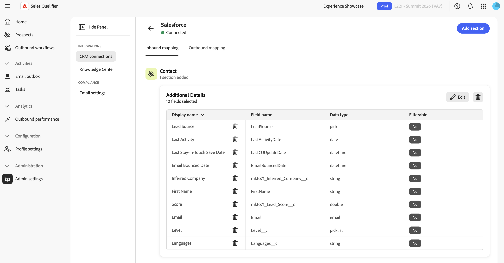

# 통합

Outlook을 연결하여 전자 메일을 보내고, 잠재 고객 답글을 인식하고, 모임을 예약합니다. 리드, 연락처, 계정, 기회, 활동 및 소유자를 Account Qualification Agent(AQA) 및 아웃바운드 워크플로에서 사용할 수 있도록 하기 위해 Sales Qualifier을 Salesforce 또는 Microsoft Dynamics 365에 연결할 수도 있습니다. Sales Qualifier은 CRM 데이터를 읽고, CRM에 도달 활동 및 옵트아웃 상태를 다시 쓸 수 있으며, 도달 활동을 Marketo에 동기화할 수 있습니다. 그렇지 않으면 CRM 레코드를 수정하지 않습니다.

이 문서에서는 Outlook 연결, CRM 연결 관리, 필드 매핑, 활동 동기화 및 이메일 옵트아웃 구성 방법에 대해 설명합니다. CRM을 처음 연결하려면 [시작](getting-started.md#connect-your-crm)을 참조하세요.

>[!IMPORTANT]
>
>Outlook 연결은 대표마다 다릅니다. 이 문서의 뒷부분에 설명된 CRM 및 규정 준수 설정은 전체 조직에 적용됩니다. 이러한 조직 전체 설정에 액세스하려면 `Sales Qualifier` 및 `Sales Qualifier Admins` 사용자 그룹에 속해야 합니다. 표준 사용자는 구성된 CRM 데이터 및 필터를 사용할 수 있지만 설정을 변경할 수는 없습니다. [사용자 역할 및 권한](user-roles-permissions.md)을 참조하세요.

## Outlook 연결

각 담당자는 자신의 Outlook 계정을 연결합니다.

1. **[!UICONTROL Outlook 연결]**&#x200B;을 선택합니다.
1. Microsoft 계정으로 로그인
1. 요청된 액세스 권한을 검토하고 승인합니다.

이 연결을 통해 Sales Qualifier은 사서함에서 메시지를 보내고, 잠재 고객이 답글을 달 때 이를 인식하고, 달력에서 모임을 예약할 수 있습니다.

연결할 때 Sales Qualifier에서 다음을 수행할 수 있도록 하는 액세스를 승인합니다.

* 잠재 고객의 답글을 인식합니다.
* 귀하를 대신하여 이메일을 만들고 전송합니다.
* 일정을 예약하려면 캘린더를 사용하십시오.
* 예약하기 위해 사서함 시간대 및 작업 시간을 읽습니다.
* 다시 로그인하지 않아도 이러한 기능이 계속 작동하도록 자동으로 로그인 상태를 유지합니다.

### Outlook 승인(필요한 경우)

기본적으로 관리자 작업은 필요하지 않습니다. 각 대표는 Outlook을 연결할 때 자신에 대한 액세스를 승인합니다.

조직에서 Microsoft 365 또는 Microsoft Entra의 서드파티 앱에 대한 사용자 동의를 해제한 경우 Microsoft 365 또는 Entra 관리자는 전체 조직에 대해 Sales Qualifier을 한 번 승인해야 합니다. 담당자가 Outlook 계정에 연결하기 전에 관리자가 이 승인을 완료합니다. 조직 전체 승인 후 각 담당자가 자신의 계정을 연결할 수 있습니다.

### Sales Qualifier에서 사서함 데이터를 처리하는 방법

Sales Qualifier은 전송된 이메일에 대한 답장만 읽고 나머지 받은 편지함은 읽지 않습니다. 활성 참여 외부에서 들어오는 첨부 파일 또는 전자 메일은 저장하지 않습니다. 저장된 로그인 자격 증명이 암호화됩니다.

## CRM 설정 열기

왼쪽 탐색에서 **[!UICONTROL 관리]**&#x200B;를 확장하고 **[!UICONTROL 관리 설정]**&#x200B;을 선택합니다. 설정은 두 개의 그룹으로 구성됩니다.

| 그룹 | 항목 |
| --- | --- |
| **[!UICONTROL 통합]** | **[!UICONTROL CRM 연결]**, **[!UICONTROL 기술 자료 센터]** |
| **[!UICONTROL 규정 준수]** | **[!UICONTROL 전자 메일 설정]** |

기술 자료실은 [기술 자료실](knowledge-center.md)을 참조하세요.

## CRM 연결 관리

**[!UICONTROL CRM 연결]**&#x200B;을 선택하십시오. 페이지에 **[!UICONTROL Salesforce]** 및 **[!UICONTROL Microsoft]**&#x200B;용 카드가 있습니다(Microsoft Dynamics 365). 각 카드에는 다음 상태 중 하나가 표시됩니다.

| 상태 | 의미 |
| --- | --- |
| **[!UICONTROL 연결됨]** | 연결이 활성 상태이고 인증되었습니다. |
| **[!UICONTROL 활성화되지 않음]** | 이 CRM에 대해 구성된 연결이 없습니다. |
| **[!UICONTROL 필요한 권한]** | 연결이 인증되었지만 필수 범위가 누락되었습니다. 카드에 누락된 범위가 나열됩니다. |

>[!NOTE]
>
>한 번에 하나의 CRM만 활성화할 수 있습니다. 한 CRM이 연결되어 있으면 다른 카드가 비활성화됩니다. 다른 CRM에 연결하기 전에 활성 CRM의 연결을 끊습니다.

구성되지 않은 카드에 **[!UICONTROL 연결]**&#x200B;이 표시됩니다. 구성된 카드에 **[!UICONTROL 구성 편집]** 및 **[!UICONTROL 연결 해제]**&#x200B;가 있는 **[!UICONTROL 관리]** 및 **[!UICONTROL 추가]** 메뉴가 표시됩니다.

### 연결 연결 또는 편집

1. CRM 카드에서 **[!UICONTROL 연결]**&#x200B;을 선택하거나 **[!UICONTROL 자세히]** > **[!UICONTROL 구성 편집]**&#x200B;을 선택하여 기존 연결을 업데이트합니다.
1. CRM 관리자의 자격 증명을 입력합니다.

   >[!BEGINTABS]

   >[!TAB Salesforce]

   **[!UICONTROL 클라이언트 ID(소비자 키)]**, **[!UICONTROL 인스턴스 URL]** 및 **[!UICONTROL 클라이언트 암호]**&#x200B;를 입력하십시오. 정식 인스턴스 URL 양식 `https://{{mydomain}}.my.salesforce.com`을(를) 사용합니다.

   {width="800" zoomable="yes"}

   >[!TAB Microsoft Dynamics]

   **[!UICONTROL 클라이언트 ID(소비자 키)]**, **[!UICONTROL 테넌트 ID]**, **[!UICONTROL Microsoft Dynamics 인스턴스 URL]** 및 **[!UICONTROL 클라이언트 암호]**&#x200B;를 입력하십시오. 정식 인스턴스 URL 양식 `https://{{mydomain}}.crm.dynamics.com`을(를) 사용합니다.

   >[!ENDTABS]

1. **[!UICONTROL 연결]**(또는 편집할 때 **[!UICONTROL 저장]**)을 선택합니다.

Sales Qualifier이 자격 증명을 거부하면 자격 증명이 잘못되었거나 만료된 경우, 권한이 누락되거나 인식할 수 없는 Dynamics 테넌트와 같은 원인을 식별합니다. 값을 수정하고 다시 시도하십시오.

>[!IMPORTANT]
>
>클라이언트 암호를 이메일로 보내지 마십시오. 조직의 승인된 보안 채널을 사용하여 Sales Qualifier에 자격 증명을 입력하는 사용자와 자격 증명을 공유할 수 있습니다.

### 연결 끊기

1. 연결된 CRM 카드에서 **[!UICONTROL 자세히]** > **[!UICONTROL 연결 끊기]**&#x200B;를 선택합니다.
1. 경고를 검토하고 **[!UICONTROL 연결 끊기]**&#x200B;를 선택하여 확인합니다.

>[!WARNING]
>
>CRM의 연결을 끊으면 조직의 모든 잠재 고객에 대해 아웃바운드 워크플로우가 일시 중지되며 다시 연결할 때까지 CRM에서 새 잠재 고객이 동기화되지 않습니다.

## CRM 필드 매핑(인바운드 매핑) {#map-crm-fields-inbound-mapping}

인바운드 매핑은 Sales Qualifier이 가져오는 CRM 필드와 표시 위치를 제어합니다. 필드는 섹션으로 그룹화되고 각 섹션은 엔티티 유형에 속합니다.

1. 연결된 CRM 카드에서 **[!UICONTROL 관리]**&#x200B;를 선택합니다.
1. **[!UICONTROL 인바운드 매핑]** 탭에서 **[!UICONTROL 섹션 추가]**&#x200B;를 선택합니다.
1. **섹션 선택** 단계에서 엔터티 형식을 선택한 후 **[!UICONTROL 다음]**&#x200B;을 선택합니다.

   | 엔티티 | 필드가 표시되는 위치 |
   | --- | --- |
   | **[!UICONTROL 잠재 고객]** | 잠재 고객의 **[!UICONTROL 개인]** 탭입니다. |
   | **[!UICONTROL 연락처]** | 연락처 레코드. |
   | **[!UICONTROL 계정]** | **[!UICONTROL 계정]** 탭입니다. [계정](accounts.md)을 참조하세요. |
   | **[!UICONTROL 기회]** | 계정의 영업 기회 세부 정보. |

1. **[!UICONTROL 섹션 이름]** 및 선택적 **[!UICONTROL 설명]**&#x200B;을 입력하십시오. 그런 다음 **[!UICONTROL 다음]**&#x200B;을 선택합니다.
1. **[!UICONTROL 필드 추가]** 단계에서 가져올 CRM 필드를 검색하여 선택하십시오. 그런 다음 **[!UICONTROL 다음]**&#x200B;을 선택합니다. 각 필드에는 **[!UICONTROL 표시 이름]**, **[!UICONTROL 필드 이름]** 및 **[!UICONTROL 데이터 형식]**&#x200B;이 표시됩니다.
1. **[!UICONTROL 잠재 고객]**, **[!UICONTROL 연락처]** 및 **[!UICONTROL 기회]** 섹션의 경우 [잠재 고객](prospects.md) 목록에서 담당자가 필요로 하는 각 필드에 대해 **[!UICONTROL 필터링 가능]**&#x200B;을 켜십시오.

   해당 데이터 형식이 필터링을 지원하지 않거나 다른 섹션에서 이미 사용되고 있는 경우 필드를 필터링 가능으로 만들 수 없습니다.

   **[!UICONTROL 내 영업 기회 연락처]**&#x200B;에서 필터링 가능한 영업 기회 필드는 **[!UICONTROL 단계(영업 기회)]**&#x200B;와 같은 레이블이 있는 별도의 열로 표시됩니다. 접미사는 영업 기회 속성을 연결된 연락처의 필드와 구분합니다.

1. **[!UICONTROL 미리 보기]** 단계에서 선택 내용을 확인하고 **[!UICONTROL 추가]**&#x200B;를 선택합니다.

나중에 섹션을 변경하려면 섹션 카드에서 **[!UICONTROL 편집]**&#x200B;을(를) 선택하십시오. 섹션을 제거하려면 섹션 카드에서 **[!UICONTROL 제거]**&#x200B;를 선택하십시오. 개별 필드를 제거하려면 필드 행에서 삭제 작업을 선택합니다. 각 제거를 확인합니다.

## 활동 동기화 구성(아웃바운드 매핑) {#configure-activity-sync-outbound-mapping}

Activity Sync는 CRM 및 Marketo에 Sales Qualifier Outreach 활동을 기록합니다. 이메일 전송, 열기, 클릭 및 회신된 활동에는 아웃바운드 워크플로우 이름이 포함됩니다. 담당자는 CRM의 활동을 볼 수 있고 마케팅 팀은 잠재 고객 점수 및 참여 타임라인에서 Marketo 활동을 사용할 수 있습니다.

1. 연결된 CRM 카드에서 **[!UICONTROL 관리]**&#x200B;를 선택합니다.
1. **[!UICONTROL 아웃바운드 매핑]** 탭을 엽니다.
1. **[!UICONTROL 활동 동기화]**&#x200B;를 켭니다. 설정이 즉시 저장됩니다.

활동 동기화가 꺼져 있으면 Sales Qualifier에서 인바운드 CRM 데이터를 계속 사용하지만 아웃바운드 활동을 CRM 또는 Marketo에 동기화하지 않습니다.

>[!NOTE]
>
>Activity Sync를 사용하려면 CRM에 쓰기 권한이 필요합니다. 필요한 권한이 없으면 스위치가 비활성화되고 Sales Qualifier에서 관리자에게 문의하라는 메시지가 표시됩니다. 활동 쓰기 액세스 권한을 부여하려면 CRM 관리자와 협력하십시오.

## 마케팅 하이라이트 설정 {#turn-on-marketo-engagement-filtering}

마케팅 하이라이트를 사용하면 담당자가 이메일 열기 및 클릭 수와 같은 실시간 [!DNL Marketo] 참여로 잠재 고객을 찾고 우선 순위를 지정할 수 있습니다. [Marketo 참여로 필터링](prospects.md#filter-by-marketo-engagement)을 참조하십시오.

관리자가 관련 조직 및 샌드박스에 대해 [!DNL Marketo]을(를) Sales Qualifier에 연결하는 1회 설정을 완료합니다. 이 설정에서는 Adobe Developer Console에서 API 자격 증명을 만들고, [!DNL Marketo]에서 웹후크를 구성하고, 해당 웹후크를 Smart Campaign 트리거에 추가하는 작업을 다룹니다. 전체 단계는 [마케팅 하이라이트 설정](marketing-highlights-setup.md)을 참조하십시오.

마케팅 하이라이트는 북미, EMEA 및 오스트레일리아의 모든 프로덕션 지역에서 사용할 수 있습니다.

## 글로벌 이메일 옵트아웃 구성 {#configure-global-email-opt-out}

옵트아웃 설정은 모든 아웃바운드 이메일에 구독 취소 바닥글을 추가합니다. 표준 사용자는 개별 이메일에 대해 해제할 수 없습니다.

1. 왼쪽 탐색에서 **[!UICONTROL 관리]**&#x200B;를 확장하고 **[!UICONTROL 관리 설정]**&#x200B;을 선택합니다.
1. **[!UICONTROL 준수]**&#x200B;에서 **[!UICONTROL 전자 메일 설정]**&#x200B;을 선택하세요.
1. **[!UICONTROL 모든 전자 메일에 옵트아웃 링크 포함]**&#x200B;을 켭니다.
1. **[!UICONTROL 옵트아웃 메시지 템플릿]**&#x200B;에 바닥글 텍스트를 입력하십시오. 클릭 가능한 구독 취소 링크가 나타날 `{opt_out_link}` 토큰을 포함합니다.

   예: `If you'd prefer not to receive these emails, you can {opt_out_link}.`

설정 및 템플릿이 자동으로 저장됩니다.

잠재 고객이 링크를 선택하면 Sales Qualifier은 해당 잠재 고객과의 이메일 전송을 중단하고 옵트아웃 상태를 연결된 CRM에 동기화합니다.

## CRM 액세스 범위

Sales Qualifier은 필요한 CRM 엔티티를 읽고 정의된 데이터 세트만 다시 기록합니다.

* **읽기** - 사용자, 연락처, 소유자 매핑, 리드, 계정, 기회 및 활동.
* **쓰기**—로그된 전달 활동([활동 동기화](#configure-activity-sync-outbound-mapping)가 켜져 있는 경우) 및 옵트아웃 상태.

CRM 관리자는 Salesforce 또는 Dynamics에서 API 액세스를 준비합니다. 그런 다음 Sales Qualifier 관리자가 CRM을 연결하고 인바운드 필드를 매핑한 다음 활동을 동기화할지 여부를 선택합니다. 초기 연결에는 읽기 전용 액세스가 필요합니다. 활동 동기화 및 옵트아웃 쓰기백에는 해당 쓰기 액세스 권한이 필요합니다.

>[!MORELIKETHIS]
>
>* [시작](getting-started.md)
>* [사용자 역할 및 권한](user-roles-permissions.md)
>* [계정](accounts.md)
