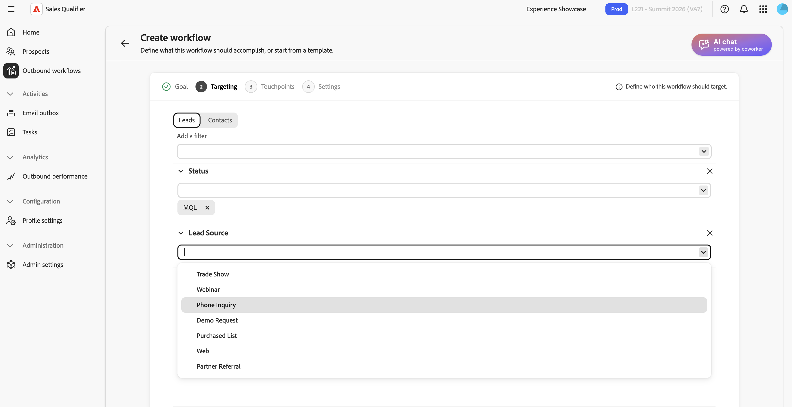
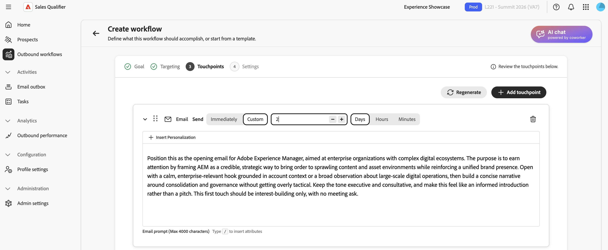
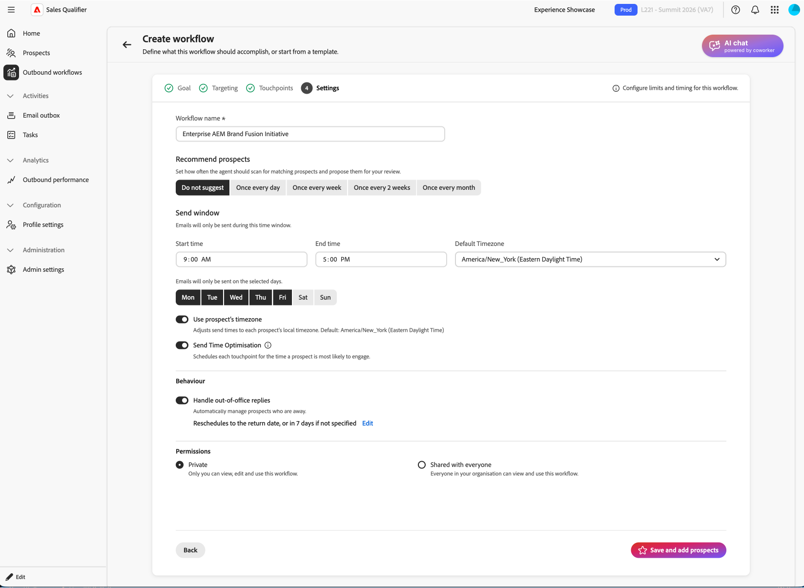

# 아웃바운드 워크플로

아웃바운드 워크플로우는 목표 중심의 전달 케이던스입니다. 목표 및 타기팅 기준을 정의합니다. 그런 다음 AI는 멀티 터치 케이던스를 제안하고 각 잠재 고객을 위해 개인화된 이메일 콘텐츠를 작성합니다. 케이던스를 활성화하기 전에 각 이메일을 검토하고 승인하십시오.

아웃바운드 워크플로우는 다음 네 가지 요소를 연결합니다.

* **목표** - 검색 통화를 예약하거나 이벤트 등록을 늘리는 등 아웃리치에서 원하는 결과입니다.
* **타깃팅 필터** - 적격한 잠재 고객을 결정하는 조건입니다.
* **접점 케이던스**—전자 메일, 전화 및 LinkedInMail 단계의 순서 순서.
* **개인화된 이메일 콘텐츠**—잠재 고객 프로필, 계정 컨텍스트, 참여 기록 및 최근 뉴스를 기반으로 한 AI 생성 콘텐츠.

AI는 이 목표를 사용하여 타깃팅 필터를 제안하고, 케이던스를 디자인하며, 터치포인트 프롬프트 초안을 작성하고, 생성된 모든 이메일을 개인화합니다.

## 주요 개념

| 개념 | 설명 |
| --- | --- |
| **아웃바운드 워크플로** | 목표, 타겟팅 필터, 케이던스 및 설정에 의해 정의된 재사용 가능한 아웃바운드 활동. |
| **목표** | 지원 활동이 달성해야 하는 작업. |
| **접점** | 등록을 기준으로 예약된 케이던스(이메일, 전화 또는 LinkedInMail)의 한 단계. |
| **접점 프롬프트** | 톤, 길이, 포커스 및 call to action을 포함하여 잠재 고객을 위한 이메일 제목 줄과 본문을 생성할 때 AI가 따르는 지침입니다. |
| **케이던스** | 터치포인트의 전체 시퀀스: 몇 개, 어떤 순서로, 어떤 날에. |
| **필터 타깃팅** | 아웃바운드 워크플로우를 잠재 고객의 하위 집합으로 제한하는 조건. |
| **초안** | 검토 준비되었지만 아직 승인되지 않은 생성된 이메일입니다. |
| **이유** | AI가 사용한 신호와 데이터 소스 등 주어진 이메일을 어떻게 작성했는지 설명한 것이다. |
| **등록** | 잠재 고객의 초안을 승인하여 아웃바운드 워크플로우의 전송 창 중에 전송할 케이던스 및 대기열 이메일을 활성화합니다. |

다음 섹션에서는 아웃바운드 워크플로우를 만들고, 생성된 이메일을 검토하고, 잠재 고객을 승인하고, 아웃바운드 워크플로우를 관리하는 방법을 설명합니다.

## 아웃바운드 워크플로우 만들기

아웃바운드 워크플로 마법사에는 **[!UICONTROL 목표]**, **[!UICONTROL 타깃팅]**, **[!UICONTROL 터치포인트 생성]**, **[!UICONTROL 설정]** 및 **[!UICONTROL 잠재 고객 추가]**&#x200B;의 5단계가 있습니다. 목표는 나머지 단계를 형성합니다.

1. 왼쪽 탐색에서 **[!UICONTROL 아웃바운드 워크플로]**&#x200B;를 선택합니다.
1. **[!UICONTROL 찾아보기]** 탭에서 오른쪽 상단의 **[!UICONTROL + 아웃바운드 워크플로 만들기]**&#x200B;를 선택합니다.

### 1단계: 목표 정의

목표는 의도한 결과를 정의하고 타겟팅, 케이던스 및 이메일 생성을 안내합니다.

1. **[!UICONTROL 처음부터 시작]**&#x200B;을 선택하여 자신의 목표를 작성하거나 **[!UICONTROL 템플릿에서 시작]**&#x200B;을 선택하여 저장된 템플릿을 사용합니다.

1. 회사와 일치하는 **[!UICONTROL 권장 목표]** 중 하나를 선택하십시오. 각 추천에는 적합한 이유에 대한 간단한 설명이 포함되어 있습니다. 목표를 채울 권장 사항을 선택하고 **[!UICONTROL 모두 보기]**&#x200B;를 선택하여 권장 사항 전체 집합을 찾아보거나 자신의 목표를 입력하십시오. **[!UICONTROL 인기 목표]** 목록에서 선택할 수도 있습니다.
1. **[!UICONTROL 다음: 타깃팅]**&#x200B;을 선택합니다.

목표에 특정 결과를 명시합니다. 예를 들어 `Promote campaign automation` 대신 `Book a 15-minute discovery call with marketing leaders evaluating campaign automation`을(를) 입력하십시오.

### 2단계: 타깃팅 필터 구성

타겟팅 필터는 적격한 잠재 고객을 정의합니다. 나중에 잠재 고객을 추가하면 이러한 필터와 일치하는 잠재 고객만 선택 목록에 나타납니다.

{width="800" zoomable="yes"}

1. 아래쪽 화살표를 선택하여 **[!UICONTROL 필터 추가]** 목록을 연 다음 필터를 선택합니다.

1. 필터에 대한 값을 설정합니다.
1. 대상 범위를 좁히려면 필터를 더 추가합니다.

1. **[!UICONTROL 다음: 터치포인트 생성]**&#x200B;을 선택하십시오.

### 3단계: 터치포인트 생성 및 검토

타깃팅을 구성하면 AI가 목표와 타깃팅 기준을 분석하고 케이던스를 정의하고 각 접점에 대한 프롬프트를 기록합니다. 케이던스에는 이메일, 전화 및 LinkedInMail 단계가 포함될 수 있습니다.

{width="800" zoomable="yes"}

이메일 터치포인트를 확장하여 프롬프트를 읽습니다. 프롬프트는 색조, 길이, 포커스 및 call to action을 포함하여 각 잠재 고객의 이메일을 작성할 때 AI를 안내합니다.

슬래시 `/`을(를) 입력하면 전자 메일을 개인화하는 데 사용할 수 있는 정의된 토큰 목록이 표시됩니다.

#### 케이던스 재생성

케이던스가 원하는 것이 아니면 **[!UICONTROL 다시 생성]**&#x200B;을 선택하고 개선 지침을 입력하십시오. 예:

* `Use three touchpoints across two weeks`
* `Lead with an executive briefing offer in the first email`
* `Add a nurture touch focused on a relevant case study`

AI는 사용자의 지침에 따라 전체 케이던스를 재작성합니다. 하나의 이메일 접점을 조정하려면 전체 케이던스를 다시 생성하는 대신 해당 프롬프트를 편집합니다.

접점 지연을 일, 시간 및 분 단위로 설정합니다. 등록 후 또는 이전 터치포인트가 완료된 후 대기 없이 터치포인트를 보내려면 일, 시간 및 분을 `0`로 설정하십시오. 더 긴 지연을 사용하여 케이던스 내에서 나중 터치포인트의 공간을 확보하십시오.

#### 프롬프트에서 지식 센터 사용

조직에서 [기술 센터](knowledge-center.md) 플레이북을 빌드한 경우 프롬프트에서 해당 플레이북을 참조하세요. 문서 이름을 지정하고 사용할 컨텍스트를 설명합니다. 예를 들어 `Use the ABC positioning guide from the Knowledge Center and focus on the security value proposition`을(를) 입력합니다.

케이던스와 프롬프트가 준비되면 **[!UICONTROL 다음: 설정]**&#x200B;을 선택합니다.

잠재 고객 이메일을 생성하기 전에 터치포인트 프롬프트를 구체화합니다. AI는 선택한 모든 잠재 고객에 대해 이러한 프롬프트를 사용합니다.

### 4단계: 아웃바운드 워크플로 설정 구성

**[!UICONTROL 설정]** 단계는 아웃바운드 워크플로의 실행 방식을 제어합니다.

{width="800" zoomable="yes"}

1. **[!UICONTROL 아웃바운드 워크플로 이름]**&#x200B;을(를) 검토하고 필요한 경우 변경합니다.
1. **[!UICONTROL 아웃바운드 워크플로우당 최대 잠재 고객 수]**&#x200B;에서 아웃바운드 워크플로우가 한 번에 관리할 수 있는 최대 잠재 고객 수를 확인합니다.
1. 아웃바운드 전자 메일의 전송이 허용되는 시간에 대해 **[!UICONTROL 전송 창]**&#x200B;을(를) 설정합니다.
1. 이메일을 보낼 수 있는 요일을 선택합니다. 주말 전송을 방지하려면 별도의 **[!UICONTROL 주말 건너뛰기]** 설정을 사용하지 않고 주중만 선택하십시오.
1. 각 잠재 고객의 가장 활발한 활동 시간에 전송 여부를 선택합니다.
1. 잠재 고객이 모임을 예약하면 후속 터치포인트를 자동으로 중지하려면 **[!UICONTROL 모임 예약 일시 중지]**&#x200B;를 켭니다.
1. 전송 타이밍에 각 잠재 고객의 시간대를 사용할지 또는 아웃바운드 워크플로 **[!UICONTROL 시간대]**&#x200B;를 사용할지 여부를 선택합니다. 아웃바운드 워크플로우 시간대를 사용하는 경우 대상과 일치하는지 확인합니다.
1. **[!UICONTROL 권한]**&#x200B;에서 **[!UICONTROL 개인]**(기본값)을 유지하거나 **[!UICONTROL 모든 사람과 공유]**&#x200B;를 선택하십시오. 자세한 내용은 [아웃바운드 워크플로 공유](#share-an-outbound-workflow)를 참조하십시오.
1. **[!UICONTROL 잠재 고객 저장 및 추가]**&#x200B;를 선택합니다.

옵트아웃 바닥글은 관리자에 의해 전역적으로 구성되며 아웃바운드 워크플로 설정과 독립적으로 아웃바운드 이메일에 적용됩니다. [전역 전자 메일 옵트아웃 구성](integrations.md#configure-global-email-opt-out)을 참조하세요.

### 5단계: 잠재 고객 추가 및 이메일 생성 시작

저장 을 선택하면 2단계의 타겟팅 필터가 적용된 잠재 고객 선택 보기가 열립니다.

1. 목록을 검토합니다.

   행에는 일반적으로 잠재 고객 이름, 계정, 이메일, 직함, 참여 상태 및 잠재 고객 상태가 포함됩니다.

1. 목록을 확장하거나 좁혀야 하는 경우 여기에서 필터를 조정합니다.
1. 확인란을 사용하여 잠재 고객을 선택합니다.
1. **[!UICONTROL 다음: 터치포인트를 검토]**&#x200B;하여 잠재 고객별 이메일 생성을 시작하십시오.

AI는 선택한 각 잠재 고객 및 이메일 접점에 대해 개인화된 이메일을 생성합니다. Phone 및 LinkedIn InMail 터치포인트는 예약된 단계로 유지됩니다. 생성하는 동안 작업을 계속하려면 **[!UICONTROL 준비되면 알림]**&#x200B;을 선택하세요.

각 잠재 고객에 대해 AI는 터치포인트 프롬프트를사람 및 계정 데이터, 참여 내역, 최근 뉴스와 결합하여 제목 줄과 본문을 생성합니다.

## 생성된 이메일 검토 및 세분화

생성이 완료되면 아웃바운드 워크플로 세부 사항 보기에서 초안을 검토하라는 메시지가 표시됩니다. Sales Qualifier은 승인하기 전까지 이메일을 보내지 않습니다.

1. 아웃바운드 워크플로 세부 정보 보기의 배너에서 **[!UICONTROL 초안 검토]**&#x200B;를 선택합니다.
1. **[!UICONTROL 터치포인트 검토]** 단계에는 두 개의 탭이 있습니다.
   * **[!UICONTROL 검토 준비됨]**—생성을 완료한 전자 메일
   * **[!UICONTROL 생성]**—아직 작성 중인 전자 메일
1. 왼쪽의 Prospect 목록에서 오른쪽에 있는 Prospect 의 터치포인트를 로드할 이름을 선택합니다.
1. 터치포인트에서 V자(**>**)를 사용하여 전체 제목 줄과 본문을 확장하고 읽습니다.

### AI 추론 읽기

생성된 각 이메일에 대해 **[!UICONTROL 추론]**&#x200B;은(는) AI가 콘텐츠와 call to action을 형성하는 신호, 특성 및 소스를 포함하여 해당 메시지를 만드는 방법을 설명합니다. 승인하기 전에 이 정보를 검토하고 개인화를 확인하십시오.

### 직접 이메일 편집

작은 단어 또는 어조 변경의 경우:

1. 확장된 터치포인트에서 **[!UICONTROL 편집]** 아이콘을 선택하여 편집기를 엽니다.
1. 제목 줄 또는 본문을 편집합니다.
1. **[!UICONTROL 저장]**&#x200B;을 선택합니다.

### AI로 이메일 세분화

구조적 또는 강조를 변경하려면 **[!UICONTROL AI로 생성]**&#x200B;을 사용하세요. AI는 개인화 컨텍스트를 유지하면서 이메일을 재작성합니다.

1. 전자 메일 편집기에서 **[!UICONTROL AI로 생성]**&#x200B;을 선택합니다.

1. 명확한 지침을 입력합니다. 예를 들면 다음과 같습니다.
   * `Make it shorter and more direct. Keep it under 100 words.`
   * `Focus more on the prospect's role and how the solution helps them specifically.`
   * `Change the call-to-action to suggest a 15-minute introductory call instead.`
1. 개정을 검토하고 필요한 경우 편집합니다.
1. **[!UICONTROL 저장]**&#x200B;을 선택합니다.

>[!TIP]
>
>직접 편집 내용을 사용하여 단어 및 색조 변경 **[!UICONTROL AI로 생성]**&#x200B;을 사용하여 전자 메일을 다시 작성하십시오.

## 잠재 고객 승인 및 등록

승인이 잠재 고객에 대한 케이던스를 활성화합니다. 시스템은 사용자가 승인하고 등록하기 전까지 잠재 고객에게 이메일을 보내지 않습니다.

1. 왼쪽 잠재 고객 목록에서 검토한 이메일이 있고 전송할 준비가 된 잠재 고객을 선택합니다.
1. 오른쪽 아래 모서리에서 **[!UICONTROL 잠재 고객 승인 및 등록]**&#x200B;을 선택합니다.

승인된 이메일은 아웃바운드 워크플로우에서 선택한 일, 전송 창, 활성 시간 옵션 및 시간대 설정에 따라 전송됩니다. 지연이 0인 터치포인트는 대기 없이 전송됩니다. 서로 다른 터치포인트는 구성된 지연을 따릅니다. 승인되지 않은 잠재 고객은 **[!UICONTROL 검토 준비됨]**&#x200B;에 남아 있습니다.

## 아웃바운드 워크플로우 공유

각 아웃바운드 워크플로우에는 **[!UICONTROL 권한]** 설정이 있습니다. 아웃바운드 워크플로는 기본적으로 **[!UICONTROL 개인]**&#x200B;입니다. 소유자가 **[!UICONTROL 모든 사람과 공유]**&#x200B;를 선택하여 팀에서 아웃바운드 워크플로를 사용할 수 있도록 만들 수 있습니다.

>[!CAUTION]
>
>공유는 영구적입니다. 아웃바운드 워크플로가 **[!UICONTROL 모든 사람과 공유]**(으)로 설정된 후에는 다시 **[!UICONTROL 개인]**(으)로 변경할 수 없습니다.

공유 아웃바운드 워크플로우에서 팀 동료는 자신의 잠재 고객을 등록할 수 있습니다. 각 사용자는 일괄 작업을 사용할 때를 포함하여 등록한 잠재 고객만 관리하거나 일시 중지할 수 있습니다. 아웃바운드 워크플로우 소유자만 일정, 시간대, 케이던스 및 기타 설정을 포함한 계획 수준 설정을 편집할 수 있습니다. 이 설정은 팀원의 경우 읽기 전용입니다.

다음 필터를 사용하여 공유 아웃바운드 워크플로 및 결과에 초점을 맞춥니다.

* **[!UICONTROL 참여 잠재 고객]** 및 **[!UICONTROL 성과]**&#x200B;에서 **[!UICONTROL 등록자]**&#x200B;를 사용하여 등록한 사람별로 잠재 고객을 필터링하세요. 이 필터는 기본적으로 등록한 잠재 고객으로 설정됩니다.
* **[!UICONTROL 찾아보기]** 탭에서 공유 필터를 사용하여 **[!UICONTROL 내가 공유]**, **[!UICONTROL 나와 공유]**, **[!UICONTROL 개인]** 또는 **[!UICONTROL 모두]**&#x200B;를 선택합니다.

## 부재 중 회신 처리

잠재 고객이 부재 중 메시지에 회신하면 아웃바운드 워크플로우가 자동으로 처리합니다.

* **자동 다시 시작**: 기본적으로 켜져 있습니다. 부재 중 회신에 반환 날짜가 포함된 경우 아웃바운드 워크플로우는 해당 날짜의 케이던스를 다시 시작합니다. 반환 날짜가 지정되지 않은 경우 팀이 구성할 수 있는 재개-후 버퍼 이후 아웃바운드 워크플로우가 다시 시작됩니다.
* **수동 옵션**: 담당자는 **[!UICONTROL 지금 다시 시작]**&#x200B;을 선택하거나 특정 다시 시작 날짜를 예약할 수 있습니다. [기존 아웃바운드 워크플로 관리](#manage-existing-outbound-workflows)를 참조하십시오.

## 기존 아웃바운드 워크플로 관리

**[!UICONTROL 아웃바운드 워크플로]** 페이지에서 **[!UICONTROL 찾아보기]** 탭에 사용 가능한 모든 아웃바운드 워크플로가 나열됩니다. 각 카드에는 목표, 구성된 터치포인트 및 성능 지표가 표시됩니다. 이 보기를 사용하여 아웃바운드 워크플로우를 모니터링하거나 초안을 검토하거나 잠재 고객을 추가합니다.

## 이메일 보낼 편지함

[전자 메일 보낸 편지함](email-outbox.md)에는 사용자 대신 보낸 자동 전자 메일과 답글이 나열됩니다.

## 회의 예약

달력에 연결하면 Sales Qualifier은 잠재 고객이 나와 시간을 예약하는 데 사용할 수 있는 개인 예약 링크를 생성합니다.

* **예약 링크**—일정 연결 및 가용성을 [프로필 설정](profile-settings.md)에서 구성하세요. 아웃바운드 이메일에 표시되도록 이메일 서명에 예약 링크를 추가합니다.
* **케이던스 배치** - Sales Qualifier이 케이던스의 관련 지점에 예약 링크를 삽입합니다. 배치를 변경할 수 있습니다.
* **예약 일시 중지**—잠재 고객이 모임을 예약하면 **[!UICONTROL 모임 예약 일시 중지]**&#x200B;가 이후 작업을 중지합니다. [4단계: 아웃바운드 워크플로 설정 구성](#step-4-configure-outbound-workflow-settings)을 참조하십시오.

[아웃바운드 성능](performance.md) 페이지에서 예약 결과를 추적합니다.

## 아웃바운드 워크플로우 모범 사례

* **특정 목표를 정의합니다.** 타겟팅, 케이던스 및 이메일은 모두 목표에서 파생됩니다. 아웃바운드 워크플로우가 달성하고자 하는 결과를 기술합니다.
* **잠재 고객별 생성 전에 접점 프롬프트를 완료합니다.** 일괄 생성 후에는 일반적으로 한 번에 한 개의 가망 고객이 변경됩니다.
* **이유를 품질 검사로 사용합니다.** 잘못된 신호가 강조되거나 관련 신호가 누락된 경우 이메일을 편집하거나 터치포인트 프롬프트를 수정하고 케이던스를 다시 생성합니다.
* **변경 내용에 편집 도구를 일치시킵니다.** 직접 편집 내용을 사용하여 단어 및 톤을 지정합니다. 재구성 또는 재구성에 **[!UICONTROL AI로 생성]**&#x200B;을 사용합니다.
* **검토한 내용만 승인하십시오.** 등록 전에 터치포인트를 확장하고 콘텐츠를 읽고 필요한 위치를 구체화합니다.

>[!MORELIKETHIS]
>
>* [작업](tasks.md)
>* [기술 자료 센터](knowledge-center.md)
>* [아웃바운드 성능](performance.md)
