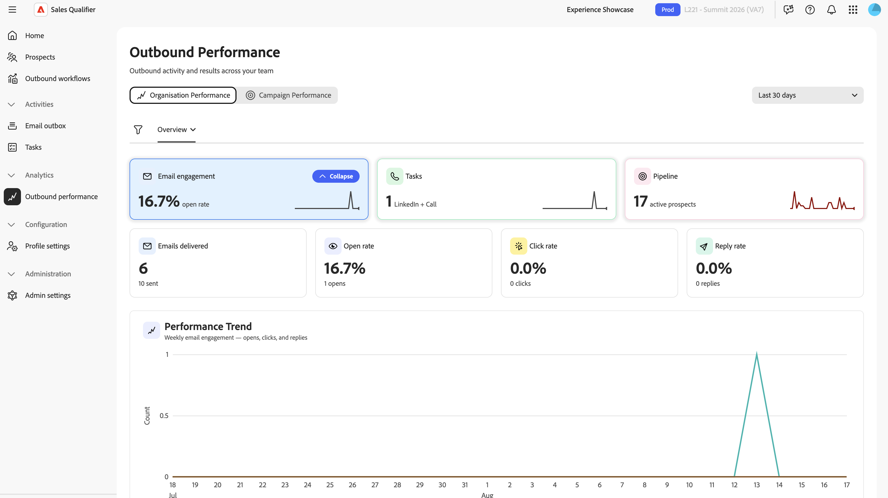

# Sales Qualifier의 아웃바운드 성능

왼쪽 탐색에서 **[!UICONTROL 아웃바운드 성능]**&#x200B;을(를) 선택하여 팀 전체의 아웃바운드 활동 및 결과를 추적합니다. 대시보드에는 **[!UICONTROL 조직 성과]** 및 **[!UICONTROL 캠페인 성과]**&#x200B;의 두 가지 보기가 있습니다.

{width="800" zoomable="yes"}

## 필터 및 기간

이 컨트롤은 보기와 모든 탭에 적용됩니다.

* **[!UICONTROL 필터]**: **[!UICONTROL 필터]**&#x200B;를 선택하여 팀 구성원과 캠페인으로 대시보드 범위를 좁힙니다.
* **[!UICONTROL 기간]**: 7, 15, 30, 60, 90, 180 또는 365일의 보고 기간을 선택하십시오.

## 조직 성과

**[!UICONTROL 조직 성과]**&#x200B;가 팀 전체의 아웃바운드 활동 및 결과에 대해 보고합니다. 여기에는 **[!UICONTROL 개요]**, **[!UICONTROL 전자 메일]** 및 **[!UICONTROL 작업]**&#x200B;의 세 가지 탭이 있습니다.

### 개요 탭

**[!UICONTROL 개요]** 탭에는 아웃바운드 결과가 한눈에 요약되어 있습니다. 상자를 클릭하면 해당 정보가 있는 차트가 표시됩니다.

* **타일**: 파이프라인, 전자 메일 참여 및 수동 활동으로, 각각 이전 기간에 대한 트렌드가 변경되었습니다.
* **성능 추세 차트**: 선택한 기간 동안의 아웃바운드 성능입니다.
* **[!UICONTROL 팀 활동]** 테이블: 담당자가 활동을 분류했습니다.

### 이메일 탭

**[!UICONTROL 전자 메일]** 탭에서 전자 메일 볼륨 및 효과에 대해 보고합니다.

* **타일**: 전송, 열기, 클릭, 회신된 전자 메일
* **주별 전자 메일 트렌드 차트**: 주별 전자 메일 활동.
* 대표 이메일 성능 테이블.

Sales Qualifier은 부재 중 회신 및 바운스에 별도의 상태를 할당하여 잠재 고객 참여와 구분할 수 있도록 합니다.

### 작업 탭

**[!UICONTROL 작업]** 탭에서 수동 전달을 보고합니다.

* **타일**: 전화 통화 및 LinkedIn 메시지 완료(완료율 포함).
* **작업 트렌드 차트**: 선택한 기간 동안 작업이 완료되었습니다.
* 대표 작업 테이블당

## 캠페인 성과

아웃바운드 워크플로우 캠페인별 아웃바운드 결과에 대한 **[!UICONTROL 캠페인 성과]** 보고서:

* **KPI 타일**: 활성 잠재 고객, 열람율, 클릭률, 응답률 및 예약된 모임.
* **캠페인 지표 트렌드 차트**: 선택한 기간 동안의 캠페인 KPI.
* **[!UICONTROL 캠페인]** 테이블: 각 캠페인에 대한 이메일, 모임, 호출 및 LinkedIn 메시지 활동. 캠페인 행을 확장하여 해당 캠페인에 대한 대표 수준 세부 정보를 확인합니다.

예약 생성 방법은 [모임 예약](outbound-workflows.md#meeting-booking)을 참조하세요.

>[!MORELIKETHIS]
>
>* [아웃바운드 워크플로](outbound-workflows.md)
>* [작업](tasks.md)
