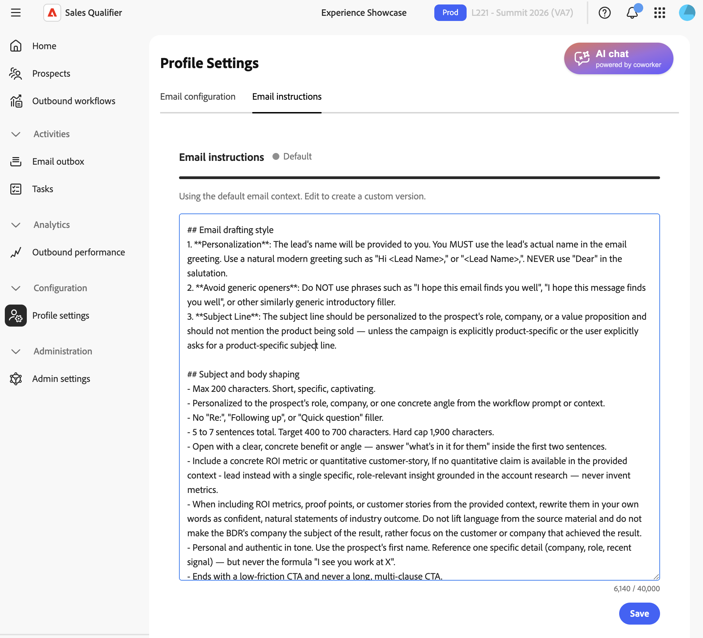
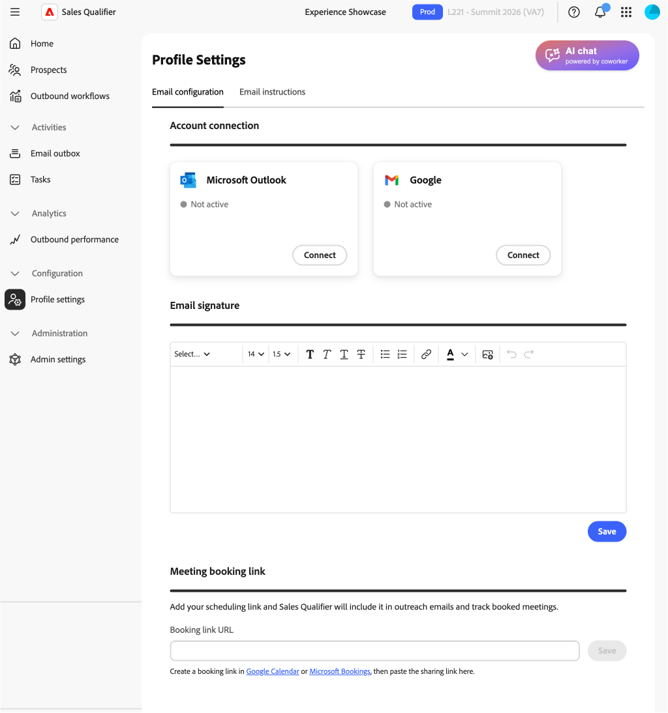

# 프로필 설정

왼쪽 탐색에서 **[!UICONTROL 구성]**&#x200B;을 확장하고 **[!UICONTROL 프로필 설정]**&#x200B;을 선택합니다. 이 설정을 사용하여 개인 세부 정보, 전자 메일 연결, 일정 및 채팅 사용 가능 여부를 관리합니다.

## 이메일 설정

**[!UICONTROL 전자 메일 설정]** 탭에서 전자 메일 연결을 설정합니다.

* **[!UICONTROL 전자 메일 연결]** — Microsoft Outlook 또는 Google을 선택하고 로그인 프로세스를 따릅니다. 승인하는 액세스 권한과 필요한 경우 관리자 승인 경로에 대해서는 [Outlook 연결](integrations.md#connect-outlook)을 참조하십시오.
* **[!UICONTROL 전자 메일 서명]** — 생성된 전자 메일에 사용된 서명을 추가하거나 업데이트합니다. 잠재 고객이 나와 시간을 예약할 수 있도록 [모임 예약](outbound-workflows.md#meeting-booking) 링크를 포함하세요.
* **[!UICONTROL 모임 예약 링크]** - 전자 메일 내에 모임 초대를 보냅니다. 회의 URL을 가져옵니다.

### 이메일 초안 컨텍스트

**[!UICONTROL 전자 메일 초안 컨텍스트]**&#x200B;를 사용하여 전자 메일이 일관되도록 전자 메일 색조, 구조 및 스타일을 설정하십시오.

**[!UICONTROL 전자 메일 초안 컨텍스트]** 영역에서 일반 Markdown으로 컨텍스트를 작성하십시오.
이를 사용하여 다음을 정의합니다.

* 음색 및 음성
* 구조 및 길이
* Personalization 및 인사말 규칙
* 제목 줄 스타일
* 참여 신호 사용 방법
* 지표, 증명 포인트 및 고객 스토리의 틀을 만드는 방법

기본적으로 초안은 하우스 스타일 컨텍스트를 사용하므로 고유한 컨텍스트를 추가하기 전까지 기존 초안이 변경되지 않습니다.

## 캘린더 구성

**[!UICONTROL 일정 구성]** 탭에서 표준 시간대 및 사용 가능 여부를 설정합니다.

* **[!UICONTROL 일정 연결]**—**[!UICONTROL 연결]**&#x200B;을 선택하고 Microsoft 로그인 프로세스를 따릅니다.
* **[!UICONTROL 모임 확인 전자 메일]** - 잠재 고객이 모임을 예약한 후 받는 확인 전자 메일의 제목과 본문을 정의합니다.
* **[!UICONTROL 기본 설정]**—기본 모임 길이와 모임 간 버퍼를 설정합니다.

캘린더 연결을 끊는 경우:

* 활성 예약 링크가 작동하지 않습니다.
* 예약 페이지에 일시적으로 사용할 수 없는 메시지가 표시됩니다.
* 다시 연결할 때 설정이 유지됩니다.

## 일정 가용성

Adobe Marketo Qualifier에서의 일정 가용성은 두 가지 입력을 기반으로 합니다.

* 연결된 작업 캘린더(예: Outlook 또는 Gmail)
* **[!UICONTROL 일정 구성]**&#x200B;의 가용성 및 시간 슬롯 규칙

Marketo Qualifier은 연결된 캘린더에서 이벤트 세부 정보가 아닌 약속 있음/없음 상태를 읽습니다. 이 보고서는 이 상태와 규칙을 결합하여 잠재 고객이 예약할 수 있는 시간대를 결정합니다.

다음을 구성할 수 있습니다.

* 요일별 작업 시간
* 하루에 여러 블록(예: 오전 9:00-정오 및 오후 1:00-5:00)
* 표준 시간대
* 회의 기간
* 모임 전/후 버퍼
* 최소 알림
* 예약 창

>[!MORELIKETHIS]
>
>* [아웃바운드 워크플로](outbound-workflows.md)
>* [통합](integrations.md)
>* [작업](tasks.md)
